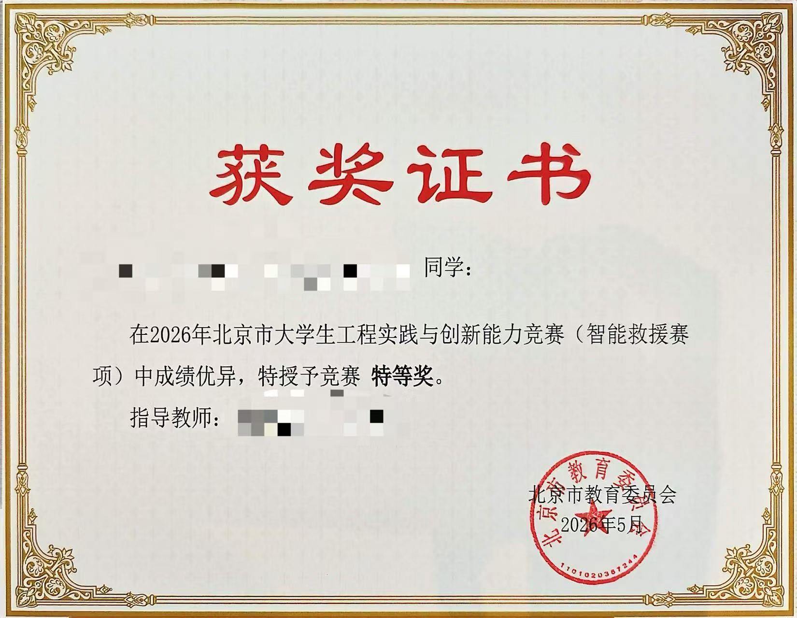
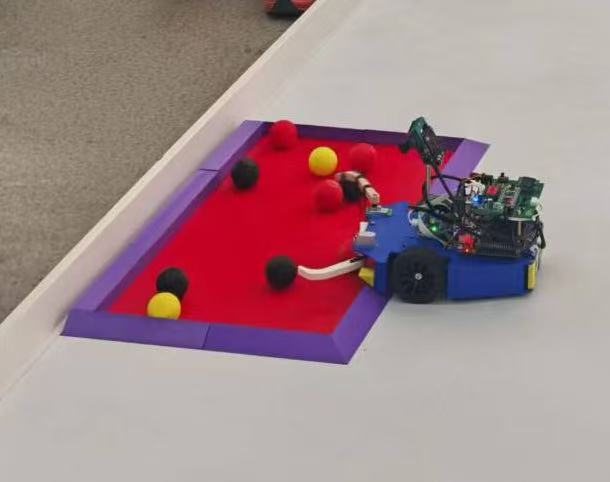

# Intelligent Rescue 2026（智能救援机器人）

> [2026 年北京市大学生工程实践与创新能力竞赛](https://jw.beijing.gov.cn/gjc/tzgg_15688/202602/t20260203_4487705.html)（智能救援赛项）机器人控制系统。

本项目基于 [Intelligent Rescue 2025](https://github.com/miofelix/intelligent-rescue-2025)，采用 **Jetson（上位机）+ STM32（下位机）** 架构，通过视觉识别与 PID 控制完成自动搜救任务。

## 🏆 成果展示

获得 **2026 年北京市特等奖、北京市智能救援赛项初赛第一名**，是初赛中**唯一完成全部球抓取的队伍**。

| 获奖证书 | 初赛全部球抓取 |
| :---: | :---: |
|  |  |

---

## 📂 项目目录结构

```text
intelligent-rescue-2026/
├── LICENSE                 # 原创代码的 MIT 许可证
├── README.md               # 项目说明文档
├── THIRD_PARTY_NOTICES.md   # 第三方代码、依赖与素材声明
├── images/                 # 获奖证书与比赛照片
│   ├── competition-award-2026.jpg
│   └── preliminary-round-all-balls-2026.jpg
├── jetson/                 # Jetson 上位机程序
│   ├── main.py             # 主程序与任务状态机
│   ├── config.py           # 全局配置与控制参数
│   ├── control.py          # 底盘运动、抓取与放球控制
│   ├── vision.py           # 视频采集与目标检测
│   ├── uart.py             # 串口通信与数据包编码
│   └── web_server.py       # 画面传输与状态监控
├── stm32/                  # STM32F103C8 下位机核心模块
│   ├── hardware/           # 硬件驱动层
│   │   ├── motor.c/h       # 电机驱动与速度控制
│   │   ├── encoder.c/h     # 电机编码器读取
│   │   ├── servo.c/h       # 舵机 PWM 控制
│   │   ├── uart.c/h        # 串口 DMA 接收与环形缓冲区
│   │   ├── oled.c/h        # SSD1306 OLED 显示驱动
│   │   └── font.c/h        # 配套字库与图模
│   └── system/             # 系统层
│       └── callback.c/h    # 控制回调与按键处理
└── electronics/            # 主控板 Gerber、BOM 与贴片坐标
```

---

## ✨ 核心功能

- **视觉识别**：基于 YOLO 识别目标球体与安全放置区，按队伍颜色筛选目标。
- **运动控制**：通过视觉 PID 调整底盘运动，配合舵机完成抓取、搬运与放球。
- **串口通信**：Jetson 与 STM32 通过自定义 UART 数据包交换控制指令与按键状态。
- **运行监控**：通过网页查看摄像头实时画面与机器人运行状态。

---

## 👥 团队信息

**2026 届开源团队：北京建筑大学 光启Ray-space工作室**

- 开源作者：李珪璠、白暄、赵天野、王宇轩、彭粲文、樊彧、覃启轩。

**2025 届原项目团队：北京建筑大学 工程实践创新中心 314 工作室**

- 原项目作者：樊彧、覃启轩。

---

## 📄 许可证

本仓库中由项目作者原创并拥有版权的源代码采用 [MIT License](LICENSE) 许可，保留 2025 年继承代码与 2026 年开源作者的版权声明。

以下内容适用各自的许可与权利声明：

- 引入或改编的第三方代码，包括 OLED 驱动及配套字库。
- 外部运行时依赖，包括 Ultralytics YOLO、PyTorch、OpenCV、NumPy、pyserial 与 STM32 HAL。
- 电路板生产资料等非源码内容，不自动适用根目录的 MIT License。
- `images/` 中的证书与比赛照片。除非另有明确许可，相关权利均予保留。

### Ultralytics 特别说明

Jetson 程序依赖 Ultralytics YOLO。其开源版本采用 **AGPL-3.0**，另提供 Enterprise 商业授权；使用与分发时需遵守所选版本及授权方式的条款，详见 [Ultralytics 官方许可说明](https://www.ultralytics.com/license)。

第三方代码的来源、使用位置与许可说明见 [THIRD_PARTY_NOTICES.md](THIRD_PARTY_NOTICES.md)。
